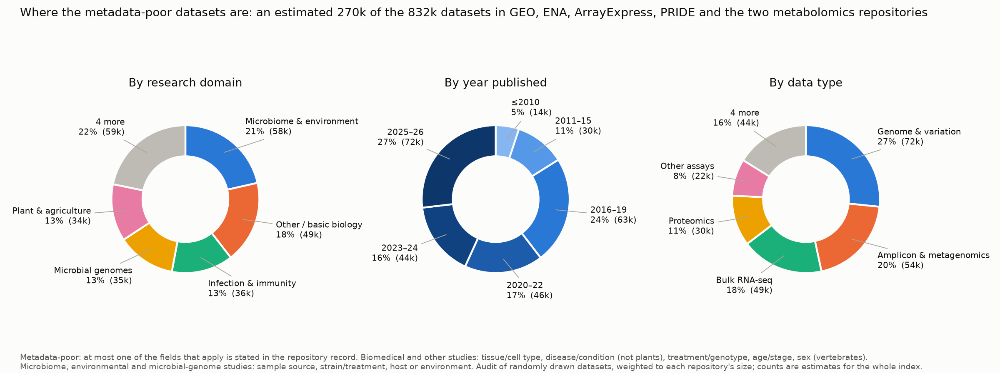
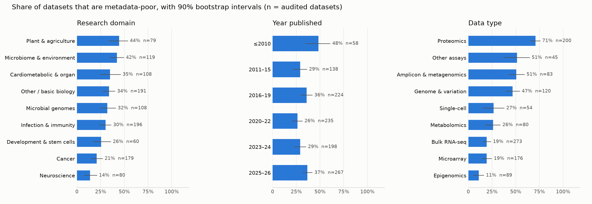
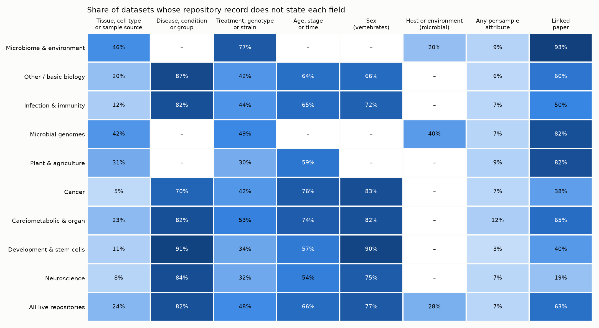

# Where locus's datasets lack sample metadata (20 Oct 2026)

The question: which datasets lack the sample metadata researchers filter on before they download, and which fields
should the next metadata-curation campaign fill first?

**Method.** We drew 1,580 datasets at random from locus's index (release data-2026-10-18), with a fixed seed and a
quota per repository. For each, we read the live repository record the way the locus study page does. For ENA we also
read every BioSample attribute; for PRIDE and ArrayExpress, the SDRF file where one exists. A field counts as stated
when an attribute or study fact carrying it is filled for at least half the samples. A field mentioned only in free text
(a title or summary) counts as missing: that is the dark data.

- 1,120 of the 1,580 drawn datasets come from the six repositories locus reads live: GEO, ENA, ArrayExpress, PRIDE,
  MetaboLights and Metabolomics Workbench. Together these hold 832k of the 888k datasets.
- Each audited dataset is weighted by its repository's size, so the counts below are estimates for the whole index.
- Intervals are 90% bootstrap intervals, resampled within each repository.

**Definition: metadata-poor.** A dataset is metadata-poor when its record states at most one of the fields that apply
to its kind of study:

- **Biomedical and other studies:** tissue or cell type, disease/condition/group, treatment/genotype, age/stage/time,
  and sex. Disease does not apply to plants; sex applies to vertebrates only.
- **Microbiome, environmental and microbial-genome studies:** sample source, strain or treatment, and host or
  environment.

Reproduce: `scripts/metadata_audit.py draw|audit`, then `scripts/metadata_gaps_report.py`. The raw evidence is in
`audit.jsonl.gz` and the per-dataset calls are in `audited.tsv`.

## Headline

**About a third of the index is metadata-poor: an estimated 270k of 832k datasets (32%, 90% interval 30–35%).**

**Where the poor datasets are (counts).** These are the biggest pools of poorly described data:

- **By domain:** microbiome & environment (58k), basic biology not otherwise classified (49k), infection & immunity
  (36k), microbial genomes (35k), plant & agriculture (34k).
- **By data type:** genome & variation (72k), amplicon & metagenomics (54k), bulk RNA-seq (49k), proteomics (30k).
- **By year:** 2025–26 (72k) and 2016–19 (63k).

**How likely a dataset is to be poor (rates).** This is where a reader is most likely to hit a poorly described
dataset:

- **Proteomics is worst: 71%.** 83% of PRIDE projects have no per-sample table at all, and only 18% attach an SDRF.
- **By domain:** plant & agriculture (44%) and microbiome & environment (42%) are worst. Neuroscience (14%) and cancer
  (21%) are best.
- **By year:** the rate is highest for ≤2010 (48%). It falls to 26% in 2020–22, then **rises again to 37% in 2025–26**,
  so the problem is not just legacy data.
- **By repository:** PRIDE 71%, ENA 42%, ArrayExpress 30%, GEO 12%. GEO's required sample characteristics carry it.

## Fields most in demand

| Field (where it applies) | Not stated anywhere | Stated per sample |
|---|---|---|
| Disease, condition or group | **82%** | 16% |
| Sex (vertebrates) | **77%** | 23% |
| Age, stage or time | **66%** | 34% |
| Linked paper (as locus reads it) | **63%** (ENA 95%) | – |
| Treatment, genotype or strain | 48% | 52% |
| Host or environment (microbial studies) | 28% | 72% |
| Tissue, cell type or sample source | 24% | 72% |

Almost every record has some per-sample table (93%). What is missing is **the variable that separates the groups**:
disease or condition, then sex and age. These are the fields a researcher needs to choose cases and controls, and they
are exactly what locus's case/control screen has to infer today.

## Curation campaign: what to fill first, and from where

1. **PRIDE per-sample tables (about 30k poor datasets; highest rate).** Rebuild an SDRF-like sample table from what
   already exists:
   - the raw-file and search-table sample names locus already parses;
   - the pridemap method tags (41k projects);
   - the paper's methods section (Europe PMC full text).

   This is also what the MaxQuant and study-page analysis path needs.
2. **Disease/condition for biomedical GEO and ENA studies.**
   - About 14% of biomedical records that lack it name a cell line (84 of 622 in the audit, unweighted), so Cellosaurus
     can fill the disease directly.
   - The rest come from GEO sample titles ("Footprint for Torin1-treated…"), group-like columns, and the paper.
3. **Sex and age for human and mouse studies.** These are usually in sample titles or the paper's methods; this is a
   job for model extraction with the evidence quoted, then a human check.
4. **Microbial, environmental and plant studies.**
   - Map ENA attributes to the MIxS checklist fields (host, env_*, geo_loc_name, collection_date), and cultivar, ecotype
     and developmental stage for plants.
   - Link papers with Europe PMC's accession text-mining, since 95% of ENA projects carry no paper link.
5. **locus's own reading gaps (not repository gaps).**
   - 56k datasets in 12 repositories are seen only through locus's index, because locus has no live reader for them:
     EGA 16k, MassIVE 12.7k, iProX 8.2k, NODE 7.9k, jPOST, PeptideAtlas, CELLxGENE, dbGaP, LINCS, Panorama, EVA and
     Expression Atlas.
   - The ArrayExpress reader skips the SDRF file when BioStudies has no characteristics table. The audit reads it; the
     study page should too.

Every filled value should carry its source (the attribute, the paper sentence, or the Cellosaurus entry), as the
locus copy rules require. Filled values go into the `metadata` table and the full-text search index, which also closes
the search-recall gap agreed on 19 Oct.

## Caveats

- **Detection is by attribute name.** A field counts only if an attribute or column is named for it (for example
  `disease state`, `OrganismPart`). Spot checks of 22 records found two rule bugs, both fixed: CamelCase names, and
  unnamed "group" columns.
- **GEO's required "source name" counts as tissue/sample source.** This is generous: some values only say "cell
  culture".
- **Domains come from keywords in the title and summary.** Spot checks found some misclassifications; for example, a
  bacterial type strain was filed under cardiometabolic. Treat domain rates as roughly ±5 points beyond the intervals.
- **"Linked paper" is as locus reads it.** The Metabolomics Workbench reader does not read paper links, so its 100%
  missing is a locus gap.
- **Excluded:** the 12 repositories without a live reader (56k datasets, 6% of the index).
